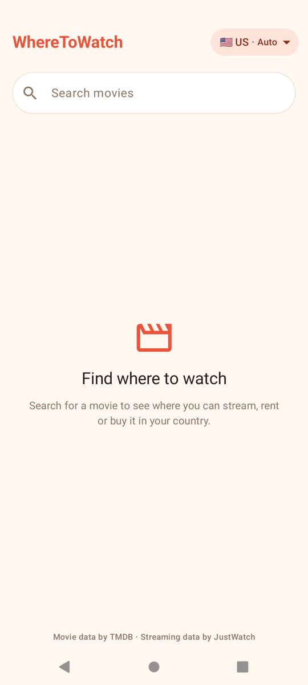
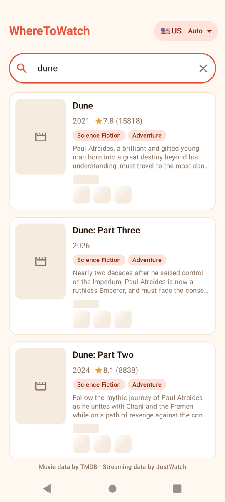
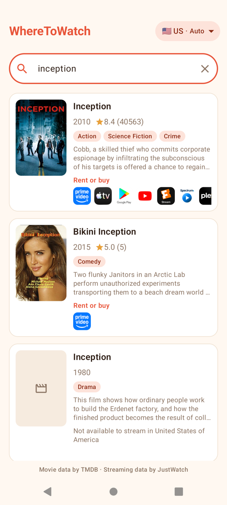
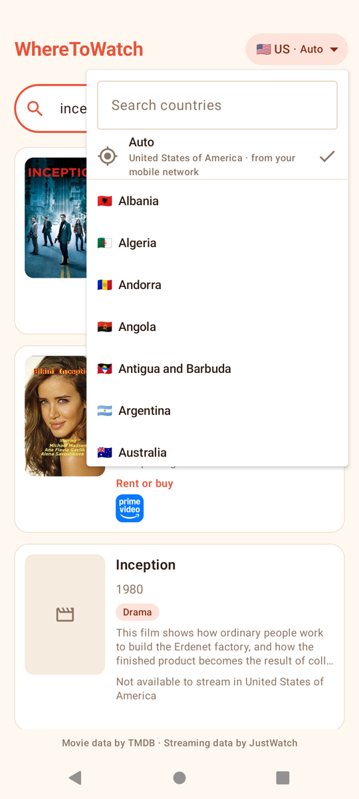
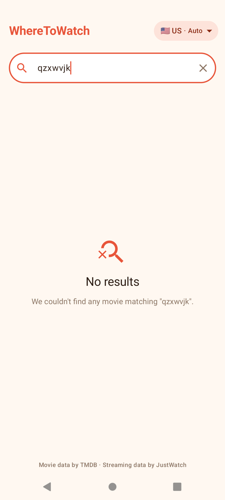
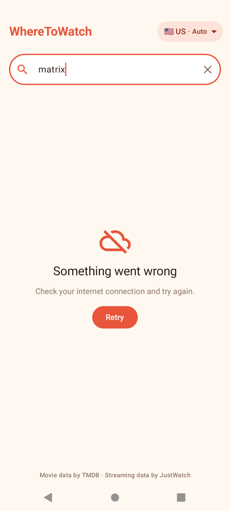

# WhereToWatch 🎬

WhereToWatch is an Android app that lets you search for any movie and instantly see where
you can **stream, rent or buy** it in your country.

> This app is my final project for the **[Coroutines Mastery](https://coroutinesmastery.com/)**
> course. Its focus is on using **Kotlin Coroutines and Flow**.

## What it does

- **Search as you type**: results appear when you stop typing, and a new search cancels
  the previous one.
- **Where to watch on every card**: streaming, rent and buy options for each movie, loaded
  in parallel with a shimmer while they arrive.
- **Infinite scroll**: the next page of results loads automatically near the end of the list.
- **Your country, automatically**: *Auto* detects it from your location (with fallbacks to
  the mobile network and device settings), or you can pick one from a searchable list. The
  choice is saved, and switching countries updates the providers instantly, with no new
  request.
- **Movie details**: backdrop, poster, tagline, runtime, rating, genres, overview, trailer,
  providers grouped by Stream / Rent / Buy, cast, and recommended movies. Every section loads
  independently.
- **Clear states**: loading, empty results, and errors with Retry.

## Screenshots

<table>
  <tr>
    <td align="center"> Start</td>
    <td align="center"> Loading providers</td>
    <td align="center"> Search results</td>
    <td align="center"> Country picker</td>
  </tr>
  <tr>
    <td align="center"> Movie details</td>
    <td align="center"> Where to watch and cast</td>
    <td align="center"> No results</td>
    <td align="center"> Error with retry</td>
  </tr>
</table>

## Tech stack

- **Kotlin** with **Coroutines and Flow**: `flatMapLatest`, `debounce`, `channelFlow`,
  `combine`, `stateIn`, `Semaphore`, `Mutex`, `Channel`, `suspendCancellableCoroutine`,
  `withTimeoutOrNull`
- **Jetpack Compose** and **Material 3**
- **MVVM** with separate `data`, `domain` and `ui` layers
- **Hilt** for dependency injection
- **Retrofit**, **OkHttp** and **kotlinx.serialization** for networking
- **Navigation Compose** with type-safe routes
- **DataStore Preferences** to save the selected country
- **Coil** for images
- **Unit tests** with JUnit, **kotlinx-coroutines-test** (virtual time) and **Turbine**
- **TMDB API** for movie data, with streaming availability provided by **JustWatch**

## Attribution

This product uses the TMDB API.
Streaming availability data is provided by JustWatch.
